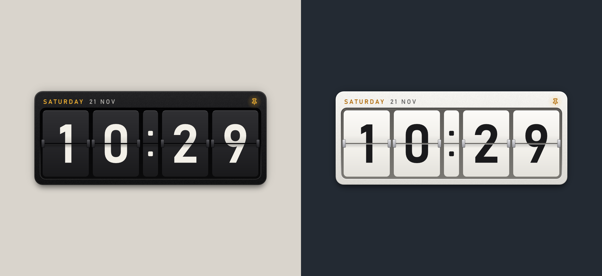
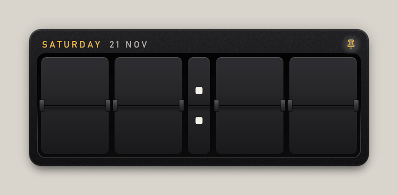

# Flip Clock

A small split-flap clock for the Windows desktop, in the style of the old airport departure boards. Free, no ads, no account, no internet connection.





## What it does

- Shows the time on flap cards that really turn, one card at a time, like the mechanical boards did.
- **Move it:** drag the clock anywhere on the screen.
- **Scale it:** drag an edge or a corner. It is drawn as vector shapes, so it stays sharp at any size.
- **Always on top:** click the pin in the top right corner. Amber means on.
- **Black or white**, with or without seconds: right-click the clock.
- **Start with Windows:** right-click the clock and tick it.
- It remembers where you put it, how big it is and how you set it.

## Download

Get it from the [Releases page](../../releases/latest). Two downloads do the same thing. Pick one.

| Download | Size | For whom |
|---|---|---|
| `FlipClock-1.0.0-small.zip` | 0.1 MB | PCs that have Microsoft's free [.NET 10 Desktop Runtime](https://dotnet.microsoft.com/download) installed |
| `FlipClock-1.0.0-all-in-one.zip` | 53 MB (125 MB unpacked) | Any 64-bit Windows PC, nothing to install |

There is no installer. Unpack the zip, put `FlipClock.exe` wherever you like and double-click it.

### Is it safe?

Both programs of version 1.0.0 were checked on VirusTotal on 21 November 2026. No antivirus engine flagged either of them:

| Program | Result | SHA-256 of `FlipClock.exe` |
|---|---|---|
| small | [0 of 70 engines](https://www.virustotal.com/gui/file/7e36d1439d0e790362429395d105d7ae08221ac89ce4ad9c7b89e174db215ae8) | `7e36d1439d0e790362429395d105d7ae08221ac89ce4ad9c7b89e174db215ae8` |
| all-in-one | [0 of 64 engines](https://www.virustotal.com/gui/file/221356253ae8b97c9455d946c9e7bda3022f6a8feb45a5191da0041bfe6b4eed) | `221356253ae8b97c9455d946c9e7bda3022f6a8feb45a5191da0041bfe6b4eed` |

The program is not code-signed, because a signing certificate costs money and this is a free gift. Windows may therefore show a notice for an unknown publisher when you start it for the first time. If that worries you, do not take my word for it: the complete source code is in this repository, and you can read it and build the program yourself (see below).

What the program does on your PC, in full:

- It never connects to the internet. There is no network code in it.
- It saves its settings in one small file: `%APPDATA%\FlipClock\settings.json`.
- Only if you tick "Start with Windows", it adds one entry to your own user's start-up list (`HKCU\Software\Microsoft\Windows\CurrentVersion\Run`). Untick it and the entry is gone.

## Light on the PC

Between two changes of the display the clock does nothing at all. With seconds hidden it wakes up once a minute. Measured on the author's PC: 0 ms of processor time in 10 seconds at rest, about 30 MB of memory.

## Remove it

1. Right-click the clock, untick "Start with Windows" if you had ticked it.
2. Right-click the clock, choose "Close".
3. Delete `FlipClock.exe`, and the folder `%APPDATA%\FlipClock` if you want the settings gone too.

## Tested on

Built and tested on Windows 11, 64-bit. Other Windows versions are untested.

## Build it yourself

You need the [.NET 10 SDK](https://dotnet.microsoft.com/download).

Small version:

```
dotnet publish -c Release -r win-x64 --self-contained false -p:PublishSingleFile=true -o app
```

All-in-one version:

```
dotnet publish -c Release -r win-x64 --self-contained true -p:PublishSingleFile=true -p:IncludeNativeLibrariesForSelfExtract=true -o portable
```

## Licence and credits

MIT licence, see [LICENSE](LICENSE). Do what you like with it.

- The pin icon is from [Lucide](https://lucide.dev) (ISC licence).
- The digits use Bahnschrift, a typeface that comes with Windows. It is not included here.
- The all-in-one version contains Microsoft's .NET runtime (MIT licence).

Details are in [THIRD-PARTY-NOTICES.md](THIRD-PARTY-NOTICES.md).
